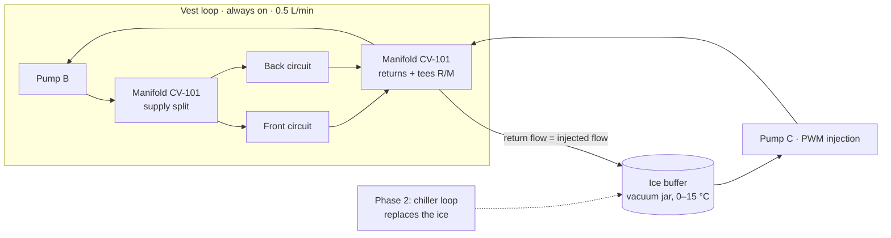

# Liquid-Cooling Vest — Project Plan v3

**Status:** v3 · 2026-10-27 · supersedes [v1](archive/plan-v1.md) · changes and reasons: [plan-review.md](plan-review.md)

## Strategy

This is a mechanical-engineering resume project on a student budget, so **CAD is the core of the work**:
- Every custom part is designed in CAD, simulated where it matters, fabricated, and tested.
- The measurements validate the simulations.
- Electronics are kept to the minimum needed to control the system and take measurements.

The project runs in two phases:

- **Phase 1 (build, ~US$300):** a working liquid-cooling vest that uses **ice water** as the cold source. The flow manifold, wearable housing, garment tube layout, and test fixtures are all custom parts. Each is designed in CAD, 3D-printed at the campus makerspace, and tested on rigs you build.
- **Phase 2 (CAD design study, US$0):** a battery-powered compressor-chiller backpack, designed as a full assembly. It includes a sheet-metal frame, a shock-mounted chiller, a protective shell, ducting, FEA and CFD, mass properties, and drawings. The Phase 1 architecture is chiller-ready, so building Phase 2 later (~US$850 more) is a direct extension.

What this shows an employer:
- A multi-part assembly taken from concept to drawings with GD&T.
- Design for 3D printing and sheet metal.
- FEA, CFD, and thermal simulation, **checked against your own measurements**.
- A documented redesign with before-and-after results.

## 1. CAD tools and conventions

- **Tool:** use the CAD package your university licenses. SolidWorks is the most common in mechanical job postings, and this project is good practice for the CSWA certification. Fusion and Onshape are free for students. Check which FEA and flow-simulation tools your licence includes.
- **Part numbers:** CV-1xx for Phase 1, CV-2xx for Phase 2, and PP-xxx for purchased parts. Revisions are lettered (A, B, …). The full list and file conventions are in [`cad/README.md`](../cad/README.md).
- **Repo contents:** native CAD files plus STEP and STL exports, PDF drawings, and PNG renders, so anyone can open the design without your CAD tool.

## 2. Phase 1 targets

| Requirement | Target |
|---|---|
| Coolant adjustment | 20–28 °C in 1 °C steps |
| Temperature regulation | Vest inlet within ±1 °C of setting after stabilization, including 25 ↔ 75 W load steps |
| Garment heat removal | ≥ 75 W from the heated torso (34 °C) at 20 °C inlet and 0.5 L/min |
| Thermal model validation | Contact simulation plus effectiveness–NTU model predicts measured heat removal within ±20% |
| Flow balance | Front and back branch flows within ±10% of each other (manifold design, CFD-checked) |
| Leak-tightness | Printed manifold and housing ports hold 50 kPa for 10 minutes without leaking |
| CAD fidelity | CAD mass properties within ±10% of the measured wearable mass |
| Measurement quality | Heater power and water-side heat agree within ±10% |
| Wearable runtime | ≥ 45 min at 75 W on one ice charge (0.6 kg) |
| Wearable mass | ≤ 3.5 kg, including ice and power bank |
| Budget | ≤ US$300 |
| Schedule | 96 h over 12 weeks (12 × 8 h, as in v1) |

## 3. Phase 1 system and custom parts

### 3.1 Water circuit

- **Vest loop.** Pump B circulates 0.5 L/min continuously through two parallel circuits, front and back. Each circuit is about 9 m of 4 × 6 mm polyurethane tubing, and the layout comes from the CAD flat pattern.
- **Injection.** Pump C injects water from the ice buffer, and the same volume returns to the buffer. A PI controller holds the vest inlet at the setpoint; at 75 W it needs only 0.05–0.15 L/min. A short 2 mm ID restriction maps pump C's usable speed range onto that flow.
- **Plumbing.** The return tee sits upstream of the injection tee, close to it, so cold water reaches the vest instead of short-circuiting back to the buffer. That geometry is built into the manifold.
- **Pressure.** The straight tubing accounts for only about 6 kPa. Measure the manifold, disconnect, and barbs, and confirm pump B against them.

### 3.2 Custom parts

| Part | What it is | CAD and engineering content |
|---|---|---|
| **CV-101 Manifold** | One block that splits supply front/back and joins the returns. It contains the R/M tees and has thermistor ports for the inlet and each branch return | Internal channels; barb or push-fit port design; O-ring glands for the sensor ports; CFD of the front/back split; designed for SLA resin (or FDM PETG with solid walls at the ports); pressure-tested; drawing with GD&T |
| **CV-102 / 103 Wearable housing and lid** | Carries the vacuum jar, both pumps, the ESP32, and the power bank, with a strap or belt mount. The lid is the UI panel for the OLED and encoder | Packaging layout; electronics bay above the water line with a drip path; snap fits and heat-set inserts; hose routing; mass and CG from CAD |
| **CV-104 Pump isolators** | TPU grommets between the pumps and the housing | Compliant-part design |
| **CV-106 Tube clips** | TPU clips that hold the tubing at a set spacing in the garment | Design for flexible printing; spacing variants for the redesign |
| **CV-107 Garment tube layout and sewing template** | A flat pattern of the tube routing, printed full size as a sewing guide | Layout sketch; equal branch lengths; bend radius ≥ the tube's kink limit |
| **CV-110 Torso rig lid** | Holds the immersion heater, stirrer, and sensors in the 19 L bucket | Fixture design |
| **CV-111 Contact band clamp** | Applies repeatable pressure between the vest and the torso | Fixture design; repeatability |
| **CV-112 Heater block clamp** | Holds the resistors on the water block | Fixture design |
| **CV-100 Phase 1 assembly** | Top-level assembly | Exploded view, renders, and BOM generated from CAD |

### 3.3 Electronics (minimal, about 10 hours)

- **Hardware:**
  - An ESP32.
  - Two ADS1115 ADCs.
  - Eight 10k NTC probes, calibrated together.
  - A hall-effect flow sensor.
  - An INA226 for heater power.
  - An OLED display with a rotary encoder.
  - MOSFET drivers for the two pumps and the heater.
- **Build:** off-the-shelf modules on perfboard, with data viewed over Wi-Fi and logged to flash.
- **Power:** a 12 V supply on the bench, and a USB-C power bank with a PD trigger board in the wearable (about 5 W).

**Interlocks:**
- Loss of flow.
- A sensor fault.
- Vest inlet more than 3 °C below the setpoint: stop injection.
- Vest inlet below 15 °C: stop both pumps.
- Buffer exhausted: warn on the display.
- Supply under-voltage.
- Torso over 40 °C: heater off.
- A physical switch that cuts everything.

### 3.4 Test rigs

- **Heater block.** A PC water block with two 3.3 Ω, 50 W resistors, PWM-controlled to 25, 50, and 75 W (about 87 W maximum at 12 V). It provides a known load for the energy-balance check and for controller tuning.
- **Heated torso.** A 19 L bucket of water held at 34 °C, standing in for skin. The heat the vest removes is the heater power plus the bucket's thermal-mass term (m·cp·dT/dt), minus a baseline measured with the coolant off. The bucket also serves as the calibration bath. Flat 30 × 30 cm test panels wrap around it for the tube-spacing comparison.

## 4. Phase 2: compressor backpack, CAD design study

| Requirement | Design target | Verified by |
|---|---|---|
| Cooling | 75 W at 30 °C ambient and 20 °C inlet, ±1 °C | Calculation and vendor data |
| Runtime and power | ≥ 60 min on battery; ≤ 60 W average | Calculation |
| Mass and volume | ≤ 6 kg; ≤ 15 L | CAD mass properties and bounding volume |
| Fall | Frame and chiller mounts keep a safety factor ≥ 2 under a 10 g drop-equivalent load (the 10 g figure is to be justified in the study) | FEA |
| Tilt | Compressor cutoff before 40°; CG as close to the back as packaging allows, with the distance reported | CAD and IMU logic |
| Airflow | Exhaust recirculation raises the condenser intake by ≤ 1 K | CFD |
| Condensation | Every surface below the dew point is insulated or drained | Design review |

**Assembly CV-200:**
- **CV-201** — a sheet-metal frame, with flat patterns for laser cutting and bending.
- **CV-202** — chiller mounts on rubber isolators (PP).
- **CV-203 / 204** — protective shell back panel and cover.
- **CV-205 / 206** — intake and exhaust ducts.
- **CV-207** — battery case.
- **CV-208** — heat shield.
- Harness interface with a hip-belt load path.
- Hose routing.

**Chiller.** The reference unit is the RIGID DV1920E-P(S) 24 V ([listing](https://www.rigidhvac.com/store/products/mini-water-chiller-dv1920e-p-s-24v), [datasheet](https://uploads.strikinglycdn.com/files/c9523143-a135-4a0a-bebd-788c411fe973/Mini%20Water%20Chiller%20Spec-DV1920E-P%28S%29%2024V.docx.pdf?id=3700598)): 230 × 200 × 145 mm, 3.5 kg, 100–400 W, a 40° tilt limit, 20–32 V, and a "−16 to 30 °C" temperature range. It is modelled from the datasheet's outline drawing.
- RIGID's site says its standard compressors are for indoor use, and only its "T" series is rated to 52 °C ambient ([compressors](https://www.rigidhvac.com/miniature-vapor-compressors)).
- It also lists a lighter personal-wear unit (2.75 kg, 260 W).
- Request data on both with the [RFQ](vendor-rfq.md).

**Design inputs already worked out** (in [`calcs/first_pass.py`](../calcs/first_pass.py) and the [decision log](decision-log.md)):
- **Cold buffer:** the chiller's minimum capacity (≥ 100 W) exceeds the 75 W load, so it charges the same buffer as Phase 1, sized at about 0.45 kg for an 8 K band. That buffer also covers about 3 minutes of cooling during a tilt or fall shutdown.
- **Battery:** 7S Li-ion, about 53 W average, so about 69 Wh nominal per hour.
- **Heat rejection:** about 124 W, giving roughly 45 °C exhaust at 15 CFM.
- **Mass:** 7.3 kg with the 3.5 kg chiller and 6.5 kg with the 2.75 kg unit. With every lever applied (a 90 Wh battery, 3 mm tubing, and a harness instead of a backpack), about 5.9 kg, which is still heavy for all-day wear.
- **Falls:**
  - An IMU cuts the compressor, and the firmware enforces an upright wait before restarting.
  - The chiller is shock-mounted inside a padded shell, because a cracked refrigerant line cannot be repaired.
  - The battery has its own protected case.
  - The mount is pre-tilted about 10° so forward lean is allowed up to about 50°.
- **Humidity:**
  - At 30 °C and 70% RH, anything below 24 °C condenses.
  - Insulate the cold lines, and add an insulating outer layer and a wicking base layer to the vest.
- **Ice vs compressor:** at 75 W, ice is lighter below about 6–7 hours of runtime (2.9 kg against 6.2–7.0 kg for 1 hour). The compressor wins only for long sessions without refills.

**Optional build later:** about US$850 ([`bom/budget.csv`](../bom/budget.csv), phase 2). Buy only after a supplier confirms the RFQ answers in writing.

## 5. Timeline

Twelve weeks at 8 h/week (96 h). Parts are ordered in week 1, and the CAD work fills the shipping wait.

| Week | Work | Deliverable or gate | h |
|---|---|---|---:|
| 1 | Freeze requirements; set up CAD and repo conventions; order parts; model the purchased parts (pumps, jar, disconnect, ESP32, power bank) | Purchased-part library; parts ordered | 8 |
| 2 | Garment tube layout and sewing template (CV-107); manifold CV-101 rev A with drawing; send the Phase 2 RFQ | Layout, template, and manifold printed | 8 |
| 3 | Housing CV-102/103, isolators, clips, torso and heater-block fixtures; print them; sew the garment at the makerspace | Printed parts; garment | 8 |
| 4 | Assemble the bench loop; pressure-test the printed parts; electronics on perfboard; calibrate the sensors and flow meter | **Gate A:** 50 kPa leak test passed; calibration record | 8 |
| 5 | Energy balance; simple PI controller; torso runs across inlet temperature and flow; measure the branch flows | Closure within ±10%; ±1 °C; first heat-removal data | 8 |
| 6 | Simulation: tube-contact thermal FEA and manifold CFD; compare with the measured heat removal and branch flows | Simulated-versus-measured comparison | 8 |
| 7 | Redesign one part (manifold rev B, or tube spacing and clips); reprint; re-measure; wearable demo; fault tests; compare CAD mass with measured mass | Before-and-after result. **Gate B:** every fault test passes before the vest is worn | 8 |
| 8 | Phase 2 CAD: chiller model from the datasheet, sheet-metal frame CV-201, isolated mounts CV-202 | Frame and mounts | 8 |
| 9 | Phase 2 CAD: shell, ducts, battery case, heat shield, harness interface; mass properties and CG | Full CV-200 assembly | 8 |
| 10 | Phase 2 analysis: FEA under the drop-equivalent load, CFD of exhaust recirculation, tilt geometry | Analysis report | 8 |
| 11 | Drawings with GD&T for the fabricated parts and frame flat patterns; exploded views; BOM; renders | Drawing package | 8 |
| 12 | Report, portfolio page, video | Portfolio | 8 |

If a week overruns, trim in this order: CFD of the condenser airflow, harness detail, renders. If you can, have a TA, professor, or design-team member review the week 11 drawings. Keep the [decision log](decision-log.md) throughout; it doubles as interview material.

## 6. Predictions and tests

**First-pass predictions** (from [`calcs/first_pass.py`](../calcs/first_pass.py); inputs marked ASSUMED are replaced as data arrives):

| Quantity | Prediction |
|---|---|
| Water ΔT at 0.5 L/min | 0.72 / 1.44 / 2.16 K at 25 / 50 / 75 W |
| Straight-tube Δp | 6.3 kPa (4 mm ID) |
| Garment heat removal at 20 / 24 / 28 °C inlet, 0.5 L/min | 150 / 107 / 64 W (94–212 W at 20 °C across contact assumptions) |
| Injection flow at 75 W | 0.05–0.15 L/min |
| Ice runtime | 80 / 55 / 42 min at 50 / 75 / 100 W |
| Wearable mass | 3.30 kg |

**Tests:**
- **Leak test:** hold the printed parts at 50 kPa for 10 minutes, before any electronics are installed and again after the garment has been flexed.
- **Sensor calibration:** calibrate the NTCs together in the stirred torso bath against a reference thermometer borrowed from a lab. Calibrate the flow sensor by timed collection on a scale, and measure each branch flow the same way.
- **Energy balance:** compare heater-block power with ṁ·cp·ΔT and report the closure.
- **Regulation:** step the setpoint between 20, 24, and 28 °C, and the load between 25 and 75 W, and plot the responses.
- **Garment:** run inlet temperatures of 20, 24, and 28 °C at flows of 0.3, 0.5, and 0.7 L/min on the heated torso. Compare the measurements with the contact FEA and effectiveness–NTU prediction, and report front and back separately.
- **Redesign:** change one part, re-measure, and report the before-and-after numbers.
- **Wearable:**
  - Compare the measured mass with the CAD mass.
  - Measure ice runtime at a controlled load.
  - After Gate B, run a short seated test at rest.
- **Faults:** test every interlock before the vest is worn.

Report every target as **met, missed, or not tested**.

## 7. Budget

Line items are in [`bom/budget.csv`](../bom/budget.csv), which has an `actual_usd` column for tracking spending.

| Phase 1 category | Allowance (US$) |
|---|---:|
| Electronics and sensors | 68 |
| Pumps, tubing, fittings, ice buffer | 83 |
| Garment | 25 |
| 3D-printing material (two revisions) | 20 |
| Test rigs (12 V supply, heater block, heated torso) | 72 |
| Contingency (~11%) | 30 |
| **Phase 1 total** | **298** |

- **Saving further:** borrow a lab bench supply (−US$25) and use a compression shirt you already own (−US$15) to bring Phase 1 to about **US$260**.
- **Free tools:** CAD software through your university or a free student licence, and the makerspace printers and sewing machine.
- **Phase 2:** costs nothing as a design study, or about US$850 to build later.

These amounts are allowances, not quotations. Custom refrigeration, medical claims, and strenuous heat-exposure testing stay out of scope.

## 8. Risks

| Risk | Mitigation |
|---|---|
| Printed manifold leaks | SLA resin, or FDM PETG with solid walls at the ports; Gate A pressure test; rev B planned |
| Parts ship slowly | Order in week 1; CAD fills the wait |
| Pump C cannot run slowly enough | 2 mm restriction; burst-mode PWM as a fallback |
| Vest removes more heat than the heater supplies | Thermal-mass term (m·cp·dT/dt) |
| Contact varies between runs | CV-111 band clamp; repeat runs; report the spread |
| Simulation tools not in your licence | Check in week 1; fall back to hand calculations and 2D conduction models |
| Phase 2 overruns | Trim order in §5 |

## 9. Safety and wearer testing

- The system is 12 V only, with no mains near water.
- The immersion heater runs only when submerged. It has a fuse and an over-temperature cutoff.
- Ice water never reaches the vest unregulated: the interlocks stop injection and the pumps on a cold inlet.
- Wearing the vest powered happens only after Gate B, seated, at rest, for short sessions, and stops at any discomfort.
- If wearer data goes into coursework or a publication, first check whether the university needs ethics review.

## 10. Portfolio and resume

The portfolio contains:
- Renders and exploded views of CV-100 and CV-200.
- A drawing package (GD&T, flat patterns, BOM).
- Simulated-versus-measured plots.
- The redesign with before-and-after numbers.
- The ice-versus-compressor chart.
- A short video of the rig and the worn vest.
- A requirements-to-results table (started in the [README](../README.md)).

Resume bullets, to be filled in with real values:

> - Designed and built a liquid-cooling vest in [CAD tool]: **[N]**-part assembly with a 3D-printed flow manifold, wearable pump housing, and test fixtures; closed-loop coolant control at 20–28 °C, ±**[X]** °C.
> - Validated designs by test: tube-contact thermal simulation within **[Z]**% of heated-torso measurements and manifold CFD flow split within **[Y]**%; increased heat removal by **[W]**% through redesign.
> - Designed a battery-powered compressor-chiller backpack: sheet-metal frame and shock-mounted chiller (FEA under a 10 g drop load, SF **[S]**), condenser ducting (CFD), and mass, CG, and energy budgets; produced GD&T drawings.
